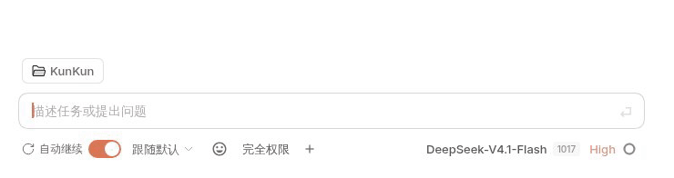

# dsh-enter-newline · Enter inserts a newline

[**简体中文**](README.md) · [English](README.en.md)


Enter inserts a newline instead of sending — half-written prompts stay in the box.



> A DeepSeek Harness (DSH) plugin for DSH 0.2.0 or newer.

## What it does

DSH sends on Enter by default, so one stray keypress can fire a half-written prompt. This plugin turns Enter into a line break; sending is done with the send button (`Shift+Enter` keeps its old behaviour).

## Features

- Enter inserts a newline and does not send
- `Shift+Enter` behaves as before (still a newline, still no send)
- Enter during Chinese IME composition is left alone, so it still picks candidates
- Toggle from the sidebar "换行设置" page without reloading

## Installation

**Option 1 — plugin marketplace (recommended)**

Search `dsh-enter-newline` in DSH's plugin marketplace.

**Option 2 — release tarball**

```bash
dsh plugin --profile web add https://github.com/KunKun24/dsh-enter-newline/releases/download/v1.1.0/dsh-enter-newline-1.1.0.tgz
```

**Option 3 — local source**

```bash
dsh plugin --profile web add link:/path/to/dsh-enter-newline
```

Reload the page afterwards.

## Usage

1. Type as usual; Enter now wraps the line
2. Send with the button on the right (or your usual send shortcut)
3. Want the old behaviour back temporarily? Sidebar → "换行设置" → turn it off

## Configuration

| Option | Default | Meaning |
| --- | --- | --- |
| Enter inserts newline | on | Off restores Enter-to-send |

Stored locally in `localStorage: dsh-enter-newline`.

## Limits & implementation

- Only the real keyboard event's `shiftKey` is rewritten and handed to Lexical — touching the DOM directly makes the editor reconcile away content (including pasted text)
- Newlines inserted by an IME's own commit are unaffected
- Paste/drag semantics are left untouched

## Data & privacy

A pure front-end plugin: no network requests, no telemetry, no writes to session files.

## Version & author

- Version **1.1.0** ([changelog](CHANGELOG.md))
- Author: 困困 (KunKun) · GitHub [@KunKun24](https://github.com/KunKun24) · Telegram [@sad1881](https://t.me/sad1881)
- License: [MIT](LICENSE)

Contains AIGC-assisted code, reviewed line by line and verified on a real instance.
