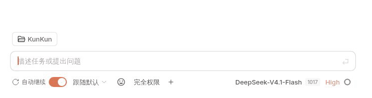

# dsh-enter-newline · 回车换行

[**简体中文**](README.md) · [English](README.en.md)


按 Enter 只换行，不发送 —— 长提示词写到一半不会再飞出去。



> DeepSeek Harness（DSH）插件，需要 DSH 0.2.0-rc.2 及以上（0.2.0-rc.2 → 0.2.3 全系列实测可用）。

## 它做什么

DSH 默认按 Enter 就直接发送。写多段提示词时，一次误按就提前把半截话发出去。这个插件把 Enter 改成插入换行，发送改为点发送按钮（`Shift+Enter` 行为不变）。

## 功能

- Enter 插入换行，不再发送
- `Shift+Enter` 保持原行为（同样换行，不发送）
- 中文输入法拼写过程中按 Enter 不拦截，回车仍然用于选词
- 侧边栏「换行设置」可随时开关，无需刷新页面

## 安装

**方式一：插件市场（推荐）**

在 DSH 的「插件市场」里搜索 `dsh-enter-newline` 直接安装。

**方式二：Release 包**

```bash
dsh plugin --profile web add https://github.com/KunKun24/dsh-enter-newline/releases/download/v1.1.1/dsh-enter-newline-1.1.1.tgz
```

**方式三：本地源码**

```bash
dsh plugin --profile web add link:/path/to/dsh-enter-newline
```

装完刷新页面即可。

## 使用

1. 输入框里正常打字，按 Enter 换行
2. 写完点右侧发送按钮（或原来的发送快捷键）
3. 想临时恢复默认发送行为：侧边栏 →「换行设置」关闭开关

## 配置

| 选项 | 默认 | 说明 |
| --- | --- | --- |
| Enter 换行 | 开 | 关闭后 Enter 恢复发送 |

设置保存在本机浏览器 `localStorage: dsh-enter-newline`。

## 限制与实现

- 只改写真实键盘事件的 `shiftKey`，交给 Lexical 自己处理，不直接改 DOM —— 否则编辑器 reconcile 时会把内容重置（粘贴的文字也会一起丢）
- 通过输入法软件“上屏”的换行不受影响
- 不处理拖拽粘贴带来的换行语义

## 数据与隐私

纯本地前端插件，不发网络请求，不收集任何数据，不写入会话文件。

## 版本与作者

- 当前版本 **1.1.1**（[更新日志](CHANGELOG.md)）
- 作者：困困 · GitHub [@KunKun24](https://github.com/KunKun24) · Telegram [@sad1881](https://t.me/sad1881)
- 许可证：[MIT](LICENSE)

包含 AIGC 辅助编写的内容，已逐行人工审阅并在真机验证。
